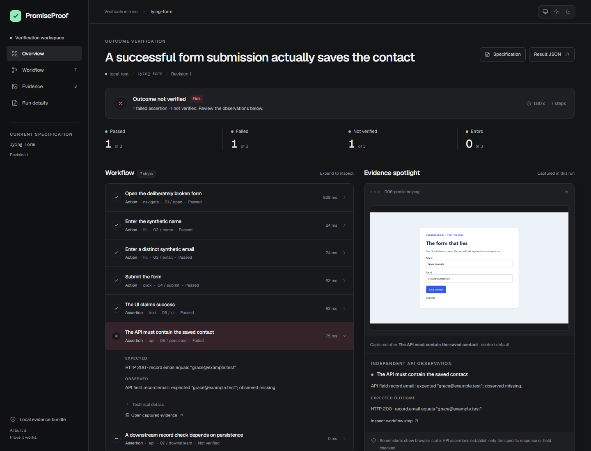

# PromiseProof

**AI built it. Prove it works.**

Verify observable software outcomes in a real browser, then review exactly which assertions passed, failed, or lacked evidence. PromiseProof combines UI checks, controlled test API checks and isolated user sessions in a versioned JSON specification. A deterministic runner produces a portable offline evidence report. No SaaS account, hosted database or LLM API key is required.



The report uses a compact verification workspace: expandable workflow steps, an evidence spotlight, embedded Geist typography, and System/Light/Dark themes. See the [light preview](docs/report-preview-light.png) and [design references](docs/design-direction.md).

**The flagship demo:** a form says “Success” but never saves the record. The UI assertion passes; the independent API assertion fails; the dependent assertion is NOT_VERIFIED. A screenshot cannot overrule the failed persistence check.

Start with the [step-by-step first-run guide](docs/getting-started.md). The doctor command now checks spec/policy compatibility and gives repair actions for setup problems; add `--json` for structured agent diagnostics. READY means setup checks passed, with `outcomesVerified: false` until you run verify.

An unsuccessful report now offers contextual **Next check** guidance and a **Next steps** section with evidence links, prerequisite navigation and local doctor/replay/trace commands. See the [real next-steps preview](docs/report-next-steps.png). Suggestions guide investigation while retaining the original observations and verdict.

## Try it locally

Node.js 22.12 or newer. From this checkout:

```sh
npm ci
npm run build
npm exec playwright install chromium
npm run demo
```

Keep the demo running. In another terminal:

```sh
node dist/cli.js init
node dist/cli.js doctor --spec examples/simple-form/spec.json
node dist/cli.js verify examples/simple-form/spec.json --config examples/config.json
node dist/cli.js verify examples/failing-workflow/spec.json --config examples/config.json
node dist/cli.js verify examples/invitation-flow/spec.json --config examples/config.json
```

Expected verification exit codes: **0**, **1**, **0**. The failure is intentional. Each command prints its report path under .promiseproof/runs/<run-id>/report.html. Open it directly in a browser. See genuine checked-in [passing](docs/sample-report/passing/report.html), [failing](docs/sample-report/failing/report.html) and [invitation](docs/sample-report/invitation/report.html) bundles.

Linux installation may require npm exec playwright install --with-deps chromium. The initial commit's [six-job CI run](https://github.com/duongnq2798/promise-proof/actions/runs/38428830158) passed on Windows, Linux and macOS with Node 22/24, including the real examples and packed consumer smoke. Follow-up changes still require their own checks.

This project is **not published to npm**. Do not use a public npx promiseproof command. Download the installable tarball from the [GitHub preview release](https://github.com/duongnq2798/promise-proof/releases/tag/v0.1.0-preview.1) and follow its [installation instructions](docs/releases/v0.1.0-preview.1.md), or run npm pack in this checkout. The provisional private package name is promiseproof-local.

## A specification, not a model verdict

```json
{
  "schemaVersion": "1",
  "id": "contact-outcome",
  "revision": 1,
  "goal": "The submitted contact exists in the test API",
  "baseUrl": "http://127.0.0.1:4173",
  "steps": [
    {
      "id": "open",
      "type": "navigate",
      "description": "Open form",
      "url": "/form"
    },
    {
      "id": "name",
      "type": "fill",
      "description": "Enter name",
      "locator": { "label": "Name" },
      "value": "Ada Example"
    },
    {
      "id": "email",
      "type": "fill",
      "description": "Enter test email",
      "locator": { "label": "Email" },
      "value": "ada@example.test"
    },
    {
      "id": "save",
      "type": "click",
      "description": "Save contact",
      "locator": { "role": "button", "name": "Save contact" }
    },
    {
      "id": "ui",
      "type": "text",
      "description": "UI confirms success",
      "locator": { "role": "status" },
      "equals": "Success"
    },
    {
      "id": "saved",
      "type": "api",
      "description": "Independent persistence check",
      "url": "/api/contacts?email=ada@example.test",
      "status": 200,
      "json": { "path": "record.email", "equals": "ada@example.test" }
    }
  ]
}
```

Use complete [examples](examples) and the generated [JSON Schema](schema/spec.schema.json). A separate policy authorizes exact origins; the specification cannot authorize itself.

## Commands and verdicts

| Command                                         | Purpose                                                        |
| ----------------------------------------------- | -------------------------------------------------------------- |
| init [--base-url URL]                           | Create policy and starter spec; preserve existing files        |
| verify SPEC --config POLICY [--json] [--headed] | Execute a validated specification                              |
| list --config POLICY                            | List saved run ids                                             |
| report RUN_ID --config POLICY                   | Print the local HTML report path                               |
| doctor --config POLICY [--spec SPEC]            | Check Node, Chromium, policy, credentials and evidence writes  |
| agent [--output NEW_FILE]                       | Read/export agent instructions without changing agent settings |

Assertions use PASS, FAIL, NOT_VERIFIED, ERROR. Failed actions also prevent overall PASS. Each step depends on its predecessor by default; explicit dependencies point backward. Exit **0** = PASS; **1** = failed/incomplete; **2** = invalid configuration/usage; **3** = runtime/infrastructure error. Errors dominate failures; failures dominate missing evidence.

## Use with a coding agent

```sh
node dist/cli.js agent --output PROMISEPROOF-AGENT.md
```

Ask Codex: “Read PROMISEPROOF-AGENT.md. Verify that a sender can invite a teammate and the recipient gains workspace membership. State boundaries, generate a revisioned spec, run it and inspect the actual result.” The runner makes every verdict. The explicit-file workflow and runner invocation were exercised during this Codex build; export/non-overwrite behavior is automated-tested.

See [agent integrations](docs/agent-integrations.md) for client-specific instructions and untested automatic-discovery boundaries.

## Why install this instead of writing Playwright directly?

Playwright already supplies browser automation, assertions and traces. PromiseProof reuses them and packages explicit outcome dependencies, missing-evidence semantics, controlled independent API observations, action-bound response checks, per-run spec copies and a reviewer-oriented report. Use Playwright Test directly for a general test framework/browser matrix. See the sourced [competitive landscape](docs/competitive-landscape.md).

## Safety and limits

Use authorized, disposable test environments. Exact origins are required for browser resources and API requests. Remote origins need a second opt-in. Browser HTTP redirects, WebSockets and service workers are blocked in this guarded MVP. Navigate directly to final URLs. This is an origin policy, not an OS/network sandbox; do not run hostile sites. No arbitrary JavaScript or shell actions are exposed.

Use environment references for credentials. Screenshots/traces are disabled with those references; captured API values also disable traces. Synthetic-run binary artifacts can contain page content. Review evidence before sharing. Never configure real payments, purchases, transfers or irreversible production operations: a generic button's business meaning cannot be inferred by the runner. See [security](docs/security.md) and [troubleshooting](docs/troubleshooting.md).

The invitation demo uses a synthetic sender session and a controlled API exposing links. **Email delivery is not verified.** Demo records live only until restart. Evidence is unsigned/editable; a spec digest identifies the executed contract, not authenticates collection.

## Development

```sh
npm run build
npm run check
npm pack
```

One inspectable TypeScript package: [spec](src/spec.ts), [security](src/security.ts), [browser](src/browser.ts), [runner](src/runner.ts), [reporter](src/reporter.ts), [CLI](src/cli.ts). See [architecture](ARCHITECTURE.md), [contributing](CONTRIBUTING.md), [verification](docs/verification.md), [security reporting](SECURITY.md) and [MIT license](LICENSE).

An existing independent project already uses PromiseProof. No affiliation is implied. Public naming, ownership and package metadata must be resolved before publication. [Release checklist](docs/release-readiness.md).
