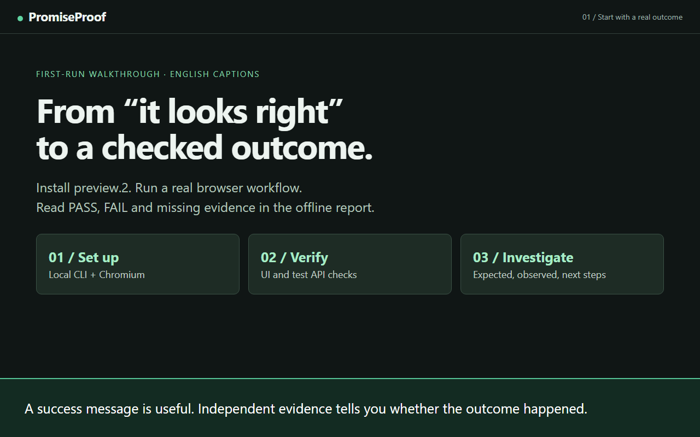

# First-run video walkthrough

[Watch or download the MP4](media/first-run.mp4) · [Offline player](media/first-run.html) · [English captions](media/first-run.en.vtt)



This 02:33 silent walkthrough has visible English captions and demonstrates the actual installed [preview.2 release](https://github.com/duongnq2798/promise-proof/releases/tag/v0.1.0-preview.2). On GitHub, open/download the MP4; the HTML player is for a local checkout. Keep the files together to use the offline player.

## Chapters

| Time  | Chapter                            |
| ----- | ---------------------------------- |
| 00:00 | Start with a real outcome          |
| 00:07 | Install the downloaded preview     |
| 00:17 | Start the local demo               |
| 00:26 | Initialize the passing example     |
| 00:35 | Check setup with doctor            |
| 00:46 | Verify the saved record            |
| 00:55 | Open the printed report.html       |
| 01:05 | Inspect independent persistence    |
| 01:15 | Try the intentional defect         |
| 01:26 | Read the actual failure            |
| 01:35 | UI success is only one observation |
| 01:44 | Compare expected with observed     |
| 01:56 | Understand NOT_VERIFIED            |
| 02:04 | Choose a concrete next check       |
| 02:14 | Replay and inspect local evidence  |
| 02:24 | Apply it to your own test app      |

## Follow along

Requires Node.js 22.12 or newer and npm. Download the tarball and SHA256SUMS.txt from preview.2, compare SHA-256, and place the tarball in a new test project. Use authorized disposable test data.

In terminal A, from that project:

```sh
npm init -y
npm install ./promiseproof-local-0.1.0.tgz
npm exec playwright install chromium
npm exec --offline -- promiseproof demo --port 0
```

On Linux, Chromium may require `npm exec playwright install --with-deps chromium`. Keep terminal A running; copy the actual URL printed by demo. Port 0 is intentional in the recording to avoid occupied ports.

In terminal B, start in the same project and use a fresh child directory for the passing example:

```sh
mkdir simple-form
cd simple-form
npm exec --offline -- promiseproof init --example simple-form --base-url PRINTED_DEMO_URL
npm exec --offline -- promiseproof doctor --spec .promiseproof/example.json
npm exec --offline -- promiseproof verify .promiseproof/example.json
```

Replace `PRINTED_DEMO_URL` with the actual URL, such as `http://127.0.0.1:4173`; do not type the placeholder literally. The child directory uses the CLI installed in its parent project. Doctor checks setup only. Verify should exit 0 for the synthetic saved-contact fixture. Open the printed report.html path.

Back in the parent project, use another fresh directory:

```sh
cd ..
mkdir failing-workflow
cd failing-workflow
npm exec --offline -- promiseproof init --example failing-workflow --base-url PRINTED_DEMO_URL
npm exec --offline -- promiseproof verify .promiseproof/example.json
```

Exit 1 is expected: UI PASS, persistence FAIL, dependent NOT_VERIFIED with zero attempts. Keep the original acceptance criterion. Open that report and inspect Expected/Observed, then Next steps and Commands and trace tools. Fix application behavior and restore test data before verifying again; this fixture is deliberately broken. Stop demo with Ctrl+C when finished.

Init preserves existing files. For your own test app, use plain init, edit the placeholder criteria and authorize its exact origin. See [getting started](getting-started.md), [specification](specification.md) and [troubleshooting](troubleshooting.md). The video does not demonstrate real email, deployment or an npm registry release.

## Transcript

**00:00 — Start with a real outcome**

A success message is useful. Independent evidence tells you whether the outcome happened.

**00:07 — Install the downloaded preview**

Use Node 22.12+. Download preview.2 and compare SHA-256 before installing in a fresh project.

**00:17 — Start the local demo**

Keep this terminal running. Port 0 chooses a free port; copy the printed URL into init.

**00:26 — Initialize the passing example**

In a second terminal, create the simple-form spec. The generated policy authorizes this exact origin.

**00:35 — Check setup with doctor**

READY describes setup checks. Doctor does not test application outcomes; verify does.

**00:46 — Verify the saved record**

Run verify on the generated spec. Exit 0 means its recorded assertions passed.

**00:55 — Open the printed report.html**

Open the printed report path in your browser. This is the actual bundle from the recorded run.

**01:05 — Inspect independent persistence**

The passing workflow reloads the page and checks the saved contact through the test API.

**01:15 — Try the intentional defect**

Use another fresh directory: init preserves existing files. Select failing-workflow with the same demo URL.

**01:26 — Read the actual failure**

Exit 1 is expected for this deliberately broken fixture. The report preserves the failed persistence check.

**01:35 — UI success is only one observation**

The UI assertion passes: the form really displayed “Success”. That does not prove the record was saved.

**01:44 — Compare expected with observed**

The API check expected the saved email. The recorded response has no contact, so persistence FAILS.

**01:56 — Understand NOT_VERIFIED**

The downstream check has zero attempts because persistence failed. Missing evidence is not a PASS.

**02:04 — Choose a concrete next check**

Open Next steps. Follow the linked observation and investigate the app without weakening the expected outcome.

**02:14 — Replay and inspect local evidence**

Commands and trace tools shows setup, replay and trace commands for this run. Share the whole evidence folder.

**02:24 — Apply it to your own test app**

Keep real acceptance criteria and exact authorized origins. Fix the app, restore test data, then verify again.

## Recording provenance

[FACT] Recorded on 2026-10-14 with Node v24.12.0, using the actual downloaded preview.2 tarball from source commit `0c6d48de6b72f9a952a0949cf47a3a88a48dcbe0`. Its SHA-256 was checked before installation. The two fresh CLI runs returned PASS/0 and FAIL/1; report interactions use those runs' actual bundles.

[FACT] The command output is replayed at a readable pace after execution; waiting time is omitted and local consumer path prefixes are shortened. Installation used local npm cache and no-audit/no-fund flags; demo used the equivalent installed Node entrypoint. All displayed verdicts and observations are unchanged. This is a captioned browser recording, not a recording of a native terminal window or an external-user usability study.

See [captured session output](media/first-run-session.txt) and [source, run ids, digests and assertion observations](media/first-run-recording.json). Report bundles remain in the local capture workspace; existing portable [passing](sample-report/passing/report.html) and [failing](sample-report/failing/report.html) sample bundles are separate historical runs. The video is instructional, not cryptographic attestation or exhaustive correctness proof.
